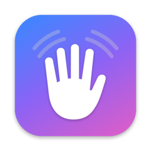
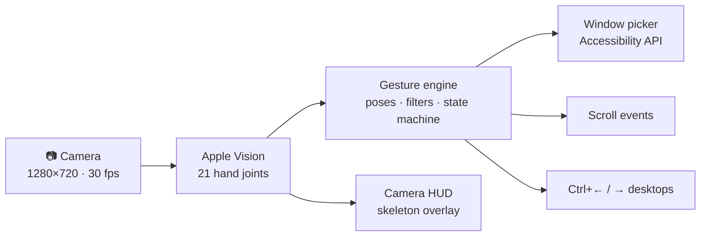

<div align="center">



# Gesture Control

**Control your Mac with hand gestures — using only the built-in camera, fully on-device.**

Switch windows, scroll and change desktops by waving your hand. No extra hardware, no cloud, no dependencies.

[](#install)
[](#build-from-source)
[](#how-it-works)
[](#privacy)
[](LICENSE)
[](https://github.com/RazinAleksandr/gesture-control/releases/latest)


<sub>Window picker: point with your index finger, hold still to open a window — or close / minimize / full-screen it.</sub>

[Русская версия](README.ru.md)

</div>

---

## Features

- 🪟 **Window picker you drive with one finger.** A quick fist → spread palm shows every window as a tile. Point, hold still, and the window opens. Each tile has close / minimize / full-screen buttons you trigger the same way.
- 📜 **Trackpad-like scrolling.** Raise two fingers and the page follows your hand; flick and fold your fingers for inertia.
- 🖥️ **Desktop switching.** Show a calm palm, then swipe left or right.
- 👍 **On/off with a thumb up.** Starts disabled, so nothing fires while you just talk with your hands.
- 🎥 **Live camera HUD** with the detected hand skeleton and the current mode.
- 🔒 **100% on-device.** Apple Vision runs locally; frames never leave memory. No network, no third-party code, ~1.3 MB app.

## Gestures

| Gesture | Action |
|---|---|
| 👍 Thumb up, hold ~1 s | Turn gestures **on / off** (a big on-screen badge + sound confirms) |
| ✊ → 🖐️ Quick fist, then palm with **all fingers spread** | **Open** the window picker |
| ☝️ Point, then hold still ~1 s | **Open the window** under your finger (a ring fills up) |
| ☝️ Hold on 🔴 🟡 🟢 on a tile | **Close** (1.5 s) / **minimize** / **full-screen** that window |
| 🖐️ → ✊ Palm, then fist (≥1.5 s after opening) | **Close** the picker — or just lower your hand for 2 s |
| ✌️ Two fingers up, move the hand | **Scroll** like a trackpad; flick + fold fingers for inertia |
| 🖐️ Calm palm, then a fast swipe ← / → | **Previous / next desktop** (Ctrl+← / Ctrl+→) |

<p align="center"><br>
<sub>The floating camera HUD shows what the app sees and which mode it is in.</sub></p>

## Install

1. Download **`GestureControl-macOS.zip`** from the [latest release](https://github.com/RazinAleksandr/gesture-control/releases/latest), unzip, and move **Gesture Control** to *Applications*.
2. The app is not notarized (no paid Developer ID), so on first launch **right-click → Open**, or run:
   ```bash
   xattr -dr com.apple.quarantine "/Applications/Gesture Control.app"
   ```
3. Allow **Camera** when asked.
4. Enable **Accessibility** (needed to scroll, switch desktops and raise / close windows):
   *System Settings → Privacy & Security → Accessibility → Gesture Control*. No restart needed.
5. A ✋ appears in the menu bar. Show 👍 for a second — and go.

Requirements: macOS 14 Sonoma or newer, Apple Silicon or Intel (universal binary), a built-in or external camera.

## Build from source

```bash
git clone https://github.com/RazinAleksandr/gesture-control.git
cd gesture-control
scripts/build-app.sh        # → dist/Gesture Control.app (universal) + dist/GestureControl-macOS.zip
```

Only the Xcode Command Line Tools are needed (`xcode-select --install`); there is no Xcode project and no package dependencies.

<details>
<summary><b>Development loop</b> (fast rebuilds without re-granting permissions)</summary>

macOS ties Camera / Accessibility permissions to the app's code signature, and ad-hoc builds change it on every rebuild. The dev setup avoids that: a tiny **launcher app is built once** and loads all logic from `libGestureCore.dylib`, which you can rebuild freely.

```bash
./build.sh                   # launcher (once) + build/libGestureCore.dylib
./run.sh                     # start; log → build/run.log
./run.sh --on --trace        # start enabled and write per-frame measurements → build/trace.log
./run.sh --camera "MacBook"  # pick a camera by name
GC_SCROLL_SIGN=-1 ./run.sh   # flip scroll direction
```

Offline checks (no camera, no permissions):

```bash
build/GestureControl.app/Contents/MacOS/GestureControl --selftest      # 34 gesture scenarios on synthetic hands
build/GestureControl.app/Contents/MacOS/GestureControl --list-windows
scripts/render-assets.sh     # regenerate the images in docs/
```
</details>

## How it works



- **Pose classification is scale-invariant:** a finger is *extended* when its tip is clearly farther from the wrist than its middle joint, *folded* when closer. Fist, open palm, two fingers, pointing and thumb-up follow from the five finger states; "spread" is measured by the index–little and thumb–index distances.
- **Stable input:** poses must hold for 4 frames; the pointer goes through a [One Euro filter](https://gery.casiez.net/1euro/); dwell counts only while the finger stays within a small radius.
- **False-positive guards:** off by default (👍 to enable), spread-palm requirement, a grace period after opening, minimum hand size (ignores people in the background), hand-presence and motion checks for swipes.
- **Performance:** ~10–20 ms of Vision work per frame on Apple Silicon at 30 fps.
- The gesture engine is pure logic (frames in → actions out) and is covered by `--selftest`.

<details>
<summary><b>Project structure</b></summary>

```
Sources/
  Camera.swift          capture + Vision hand pose
  GestureEngine.swift   poses, filters, modes (idle / scroll / picker / cooldown / off)
  WindowPicker.swift    full-screen overlay, window list & actions via Accessibility
  HUD.swift             floating camera preview with the skeleton
  Actions.swift         scroll / key events, focused-window helpers
  Toast.swift           on/off badge
  App.swift             menu-bar app, wiring, CLI flags
  SelfTest.swift        synthetic-hand scenarios
Launcher/               dev launcher (C) + standalone entry point + Info.plist
scripts/                build-app.sh, make-icon.swift, render-assets.sh
```
</details>

## Privacy

Camera frames are processed in memory by Apple's on-device Vision framework and discarded; nothing is recorded, stored or sent anywhere — the app has no network code. Accessibility is used only to list, raise, minimize, full-screen and close windows and to post scroll / arrow-key events.

## Limitations & roadmap

- The interface text is currently in **Russian**; English localization is next.
- The picker shows windows of the current desktop, with app icons and titles but no live thumbnails (those would require Screen Recording permission).
- Thresholds were tuned on one person's hand and lighting; they live in `GestureConfig` and are easy to adjust.
- Not notarized (see Install).
- Ideas: window thumbnails, configurable gesture → action mapping, a settings window, pointer mode for clicking anywhere.

Issues and pull requests are welcome.

## License

[MIT](LICENSE) © 2026 Aleksandr Razin
