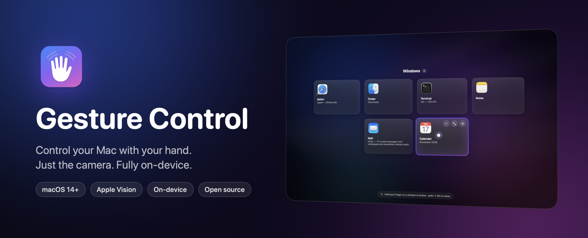
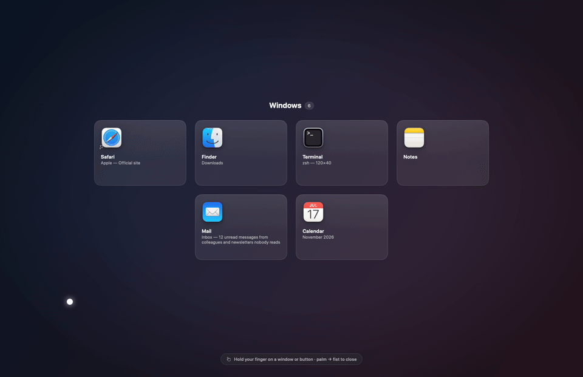
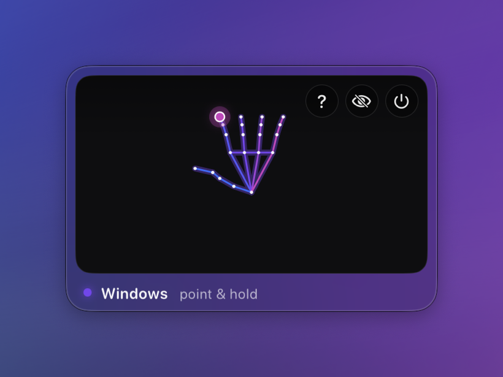
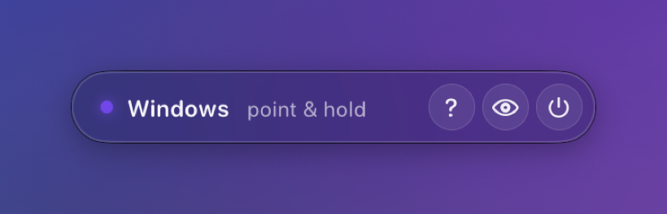
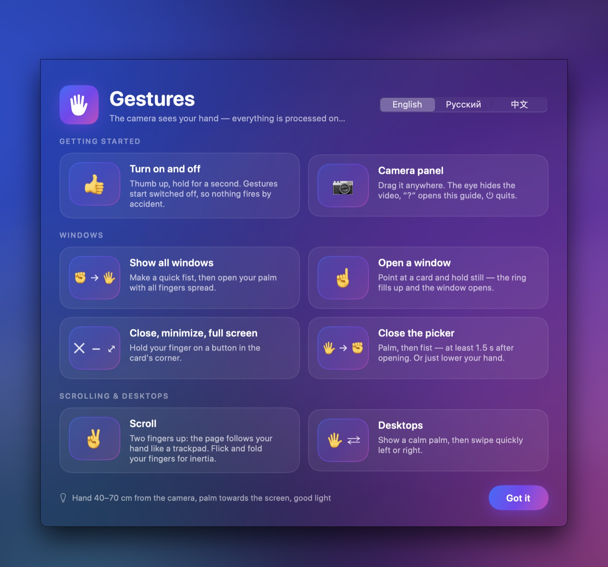
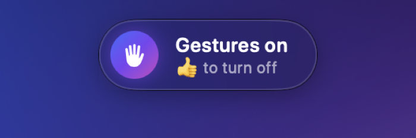
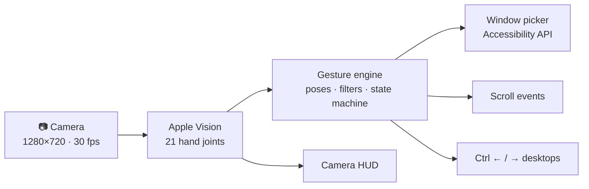

<p align="center">
  
</p>

<p align="center">
  <b>English</b> · <a href="README.ru.md">Русский</a> · <a href="README.zh-CN.md">简体中文</a>
</p>

<p align="center">
  <a href="https://github.com/RazinAleksandr/gesture-control/releases/latest"></a>
  
  
  
  
  <a href="LICENSE"></a>
</p>

<p align="center">
  <a href="https://github.com/RazinAleksandr/gesture-control/releases/latest/download/GestureControl-macOS.zip">
    
  </a>
</p>

<p align="center">
  Switch windows, scroll and change desktops with hand gestures — using only the built-in camera.<br>
  No extra hardware. No cloud. No dependencies. A 1.5&nbsp;MB menu-bar app.
</p>

<p align="center">
  
</p>

---

## ✨ Highlights

|  |  |
|---|---|
| 🪟 **One-finger window picker** | Quick fist → spread palm shows every window as a glass card. Point, hold still, and it opens. Close, minimize or full-screen any window the same way. |
| 📜 **Trackpad-like scrolling** | Raise two fingers and the page follows your hand. Flick and fold your fingers for inertia. |
| 🖥️ **Desktop switching** | Show a calm palm, then swipe left or right. |
| 👍 **Safe by default** | Starts switched off. A thumb-up held for a second turns gestures on or off, so talking with your hands never clicks anything. |
| 🎥 **Glass camera HUD** | A small draggable panel shows what the camera sees, the hand skeleton and the current mode — or collapses into a pill. |
| 🔒 **Private** | Apple Vision runs on your Mac. Frames never leave memory; there is no network code at all. |
| 🌐 **English · Русский · 中文** | Follows your system language; switch any time in the gesture guide or the menu. |

## 🖐️ Gestures

| Gesture | Does |
|:--|:--|
| 👍 &nbsp;Thumb up, hold ~1 s | Turn gestures **on / off** |
| ✊ → 🖐️ &nbsp;Quick fist, then a palm with **all fingers spread** | **Show all windows** |
| ☝️ &nbsp;Point at a card and hold still | **Open that window** — a ring fills up first |
| ☝️ &nbsp;Hold on **✕ · − · ⤢** in a card's corner | **Close** · **minimize** · **full-screen** the window |
| 🖐️ → ✊ &nbsp;Palm, then fist (≥ 1.5 s after opening) | **Close the picker** — or just lower your hand |
| ✌️ &nbsp;Two fingers up, move your hand | **Scroll** like a trackpad, flick for inertia |
| 🖐️ ⇄ &nbsp;Calm palm, then a fast swipe | **Previous / next desktop** |

> [!TIP]
> Keep your hand 40–70 cm from the camera, palm towards the screen, in decent light. The in-app guide (the **?** button) shows all of this any time.

## 🎛️ Interface

<table>
  <tr>
    <td width="50%" align="center"><br><sub><b>Camera HUD</b> — drag it anywhere. <b>?</b> opens the guide, the eye hides the video, <b>⏻</b> quits.</sub></td>
    <td width="50%" align="center"><br><sub><b>Collapsed</b> — just the mode and the buttons.</sub><br><br><br><sub><b>Gesture guide</b> — opens on first launch; switch the language at the top.</sub></td>
  </tr>
</table>

<p align="center"><br><sub><b>On/off badge</b> — appears at the top when you show 👍.</sub></p>

## 🚀 Install

1. **Download** [`GestureControl-macOS.zip`](https://github.com/RazinAleksandr/gesture-control/releases/latest/download/GestureControl-macOS.zip), unzip it and drag **Gesture Control** into *Applications*.
2. **First launch.** The app isn't notarized (no paid Apple Developer ID), so macOS blocks it once:
   click **Done** (not *Move to Trash*) → *System Settings → Privacy & Security* → scroll down → **Open Anyway** → **Open**.
3. **Allow the camera** when asked.
4. **Enable Accessibility** — *System Settings → Privacy & Security → Accessibility → Gesture Control*. It's needed to scroll, switch desktops and raise / close windows. No restart required.
5. ✋ appears in the menu bar and the gesture guide opens. Show 👍 for a second — you're in.

<details>
<summary><b>Prefer Terminal for step 2?</b></summary>

```bash
xattr -dr com.apple.quarantine "/Applications/Gesture Control.app"
```
On macOS 14, right-click → **Open** works as well.
</details>

**Requirements:** macOS 14 Sonoma or newer · Apple Silicon or Intel · built-in or external camera.

## 🛠️ Build from source

```bash
git clone https://github.com/RazinAleksandr/gesture-control.git
cd gesture-control
scripts/build-app.sh      # → dist/Gesture Control.app (universal) + dist/GestureControl-macOS.zip
```

Only the Xcode Command Line Tools are needed (`xcode-select --install`) — no Xcode project, no packages.

<details>
<summary><b>Development loop</b></summary>

macOS ties Camera and Accessibility permissions to the app's signature, and ad-hoc builds change it on every rebuild. In development a tiny **launcher app is built once** and loads all logic from `libGestureCore.dylib`, so you can rebuild without re-granting anything.

```bash
./build.sh                    # launcher (once) + build/libGestureCore.dylib
./run.sh                      # start; log → build/run.log
./run.sh --on --trace         # start enabled, write per-frame measurements → build/trace.log
./run.sh --camera "MacBook"   # pick a camera by name
./run.sh --guide              # show the gesture guide on start
GC_SCROLL_SIGN=-1 ./run.sh    # flip the scroll direction

build/GestureControl.app/Contents/MacOS/GestureControl --selftest   # 34 gesture scenarios, no camera
scripts/render-assets.sh      # regenerate the images in docs/
```
</details>

## ⚙️ How it works



- **Scale-invariant poses.** A finger is *extended* when its tip is clearly farther from the wrist than its middle joint, *folded* when closer. Fist, palm, two fingers, pointing and thumb-up follow from five finger states; "spread" uses the index–little and thumb–index distances.
- **Steady input.** A pose must hold for 4 frames; the pointer runs through a [One Euro filter](https://gery.casiez.net/1euro/); a dwell counts only while the finger stays still.
- **Guards against false positives.** Off by default, spread-palm requirement, a grace period after opening, a minimum hand size (people in the background are ignored), calm-palm checks before swipes.
- **Fast.** ~10–20 ms of Vision work per frame on Apple Silicon at 30 fps.
- **Testable.** The gesture engine is pure logic — frames in, actions out — and `--selftest` replays 34 scenarios on synthetic hands.

<details>
<summary><b>Project layout</b></summary>

```
Sources/
  Camera.swift          capture + Vision hand pose
  GestureEngine.swift   poses, filters, modes (idle · scroll · picker · cooldown · off)
  WindowPicker.swift    full-screen glass overlay; window list & actions via Accessibility
  HUD.swift             draggable camera panel with the skeleton
  GestureGuide.swift    the gesture guide window (SwiftUI)
  Toast.swift           on/off badge
  Theme.swift           colors, fonts, glass
  Actions.swift         scroll / key events, focused-window helpers
  App.swift             menu-bar app, wiring, CLI flags
  SelfTest.swift        synthetic-hand scenarios
Launcher/               dev launcher + standalone entry point + Info.plist
scripts/                build-app.sh · make-icon.swift · render-assets.sh
```
</details>

## 🔒 Privacy

Camera frames are processed in memory by Apple's on-device Vision framework and discarded. Nothing is recorded, stored or sent — the app has no network code. Accessibility is used only to list, raise, minimize, full-screen and close windows and to post scroll and arrow-key events.

## ❓ FAQ

<details><summary><b>It doesn't react to my hand.</b></summary>

Check that gestures are on (👍 for a second — a badge appears at the top), that the camera HUD shows your hand skeleton, and that your hand is 40–70 cm away with the palm facing the screen. Scrolling and desktops also need the Accessibility permission.
</details>

<details><summary><b>Which Macs are supported?</b></summary>

Any Mac with macOS 14+ and a camera, Apple Silicon or Intel.
</details>

<details><summary><b>How do I change the language?</b></summary>

The interface follows your system language (English, Russian or Chinese). Switch it any time with the selector at the top of the gesture guide (**?** button) or in the ✋ menu → *Language*.
</details>

<details><summary><b>Desktops don't switch.</b></summary>

Make sure *Keyboard → Keyboard Shortcuts → Mission Control → Move left / right a space* (Ctrl ← / →) is enabled and you have more than one desktop.
</details>

## 🗺️ Roadmap

- [x] Window picker with dwell selection and window buttons
- [x] Trackpad-like scrolling with inertia, desktop switching
- [x] Thumb-up on/off, glass HUD, gesture guide
- [x] English, Russian and Chinese interface
- [ ] Live window thumbnails
- [ ] Custom gesture → action mapping and a settings window
- [ ] Pointer mode for clicking anywhere
- [ ] Notarized build

## 🤝 Contributing

Issues and pull requests are welcome. Run `--selftest` before sending changes to the gesture engine, and `scripts/render-assets.sh` if you touch anything visual.

## 📄 License

[MIT](LICENSE) © 2026 Aleksandr Razin
