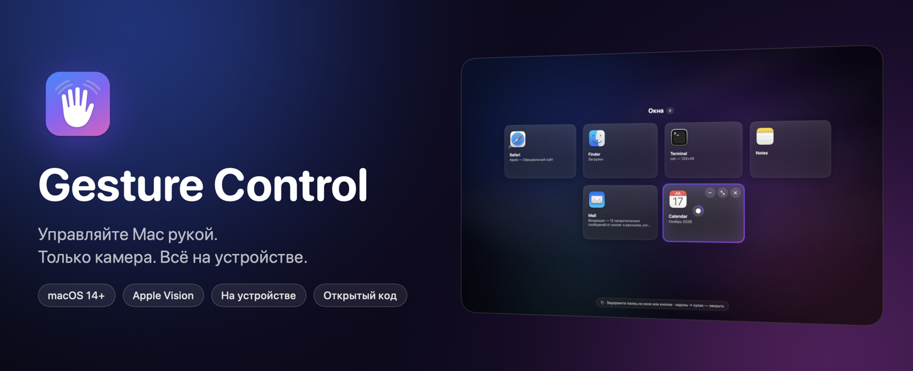
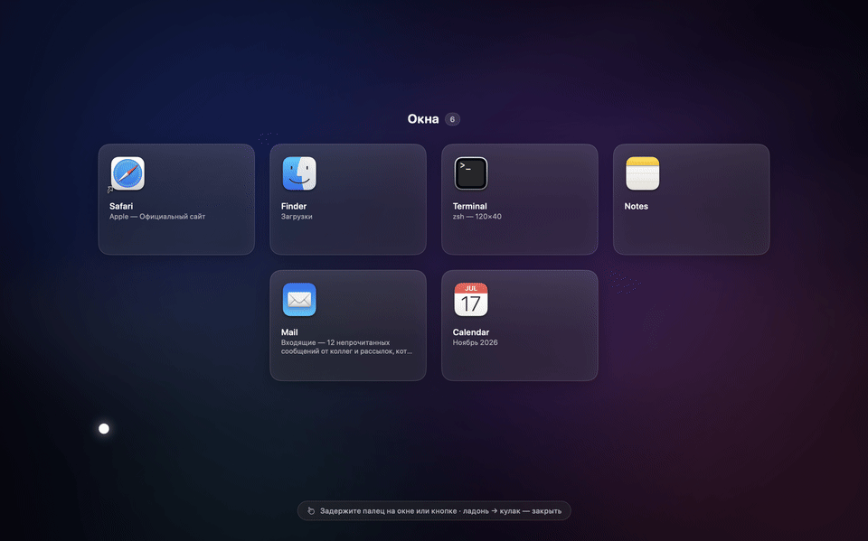
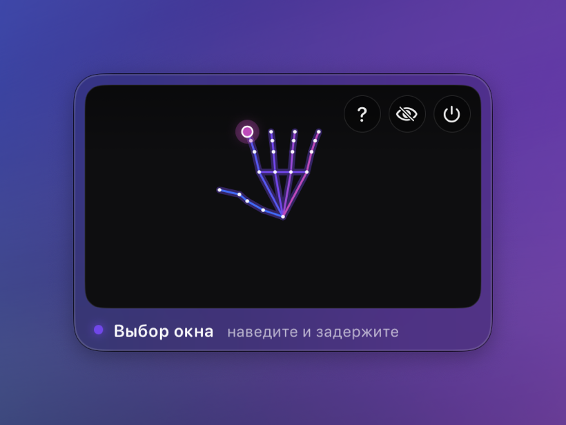
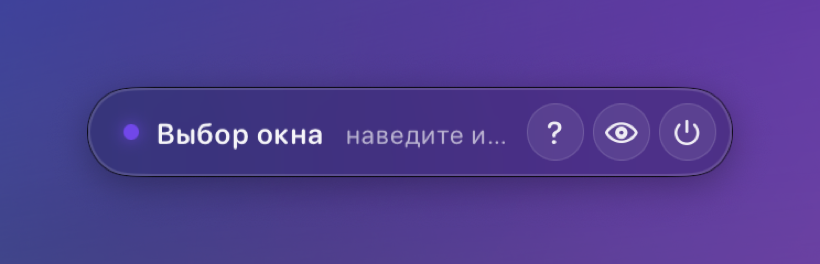
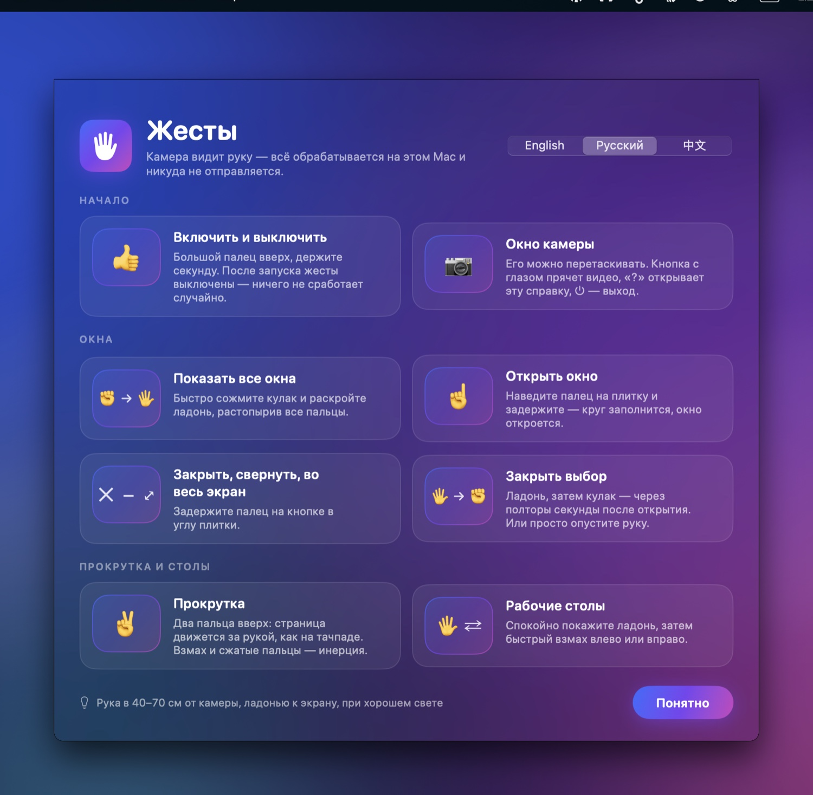
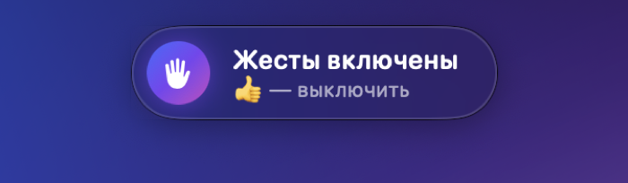

<p align="center">
  
</p>

<p align="center">
  <a href="README.md">English</a> · <b>Русский</b> · <a href="README.zh-CN.md">简体中文</a>
</p>

<p align="center">
  <a href="https://github.com/RazinAleksandr/gesture-control/releases/latest"></a>
  
  
  
  <a href="LICENSE"></a>
</p>

<p align="center">
  <a href="https://github.com/RazinAleksandr/gesture-control/releases/latest/download/GestureControl-macOS.zip">
    
  </a>
</p>

<p align="center">
  Переключайте окна, прокручивайте и меняйте рабочие столы жестами — только встроенная камера.<br>
  Без дополнительного железа, без облака, без зависимостей. Приложение в строке меню на 1,5&nbsp;МБ.
</p>

<p align="center">
  
</p>

---

## ✨ Возможности

|  |  |
|---|---|
| 🪟 **Выбор окна одним пальцем** | Быстрый кулак → растопыренная ладонь показывает все окна стеклянными карточками. Наведите палец, задержите — окно откроется. Так же закрываются, сворачиваются и разворачиваются окна. |
| 📜 **Прокрутка как на тачпаде** | Два пальца вверх — страница идёт за рукой. Взмах и сжать пальцы — инерция. |
| 🖥️ **Рабочие столы** | Спокойно покажите ладонь, затем быстрый взмах влево или вправо. |
| 👍 **Безопасно по умолчанию** | После запуска жесты выключены. Большой палец вверх на секунду включает и выключает их — разговор «руками» ничего не нажмёт. |
| 🎥 **Стеклянное окно камеры** | Маленькая панель, которую можно перетаскивать: видно, что видит камера, скелет руки и режим. Сворачивается в плашку. |
| 🔒 **Приватно** | Apple Vision работает на вашем Mac. Кадры не покидают память, сетевого кода нет вообще. |
| 🌐 **English · Русский · 中文** | Язык как в системе; переключается в справке или в меню. |

## 🖐️ Жесты

| Жест | Действие |
|:--|:--|
| 👍 &nbsp;Большой палец вверх, ~1 с | **Включить / выключить** жесты |
| ✊ → 🖐️ &nbsp;Быстрый кулак, затем ладонь с **растопыренными пальцами** | **Показать все окна** |
| ☝️ &nbsp;Навести палец на карточку и задержать | **Открыть окно** — сначала заполнится кольцо |
| ☝️ &nbsp;Задержать на **✕ · − · ⤢** в углу карточки | **Закрыть** · **свернуть** · **во весь экран** |
| 🖐️ → ✊ &nbsp;Ладонь, затем кулак (через 1,5 с после открытия) | **Закрыть выбор** — или просто опустить руку |
| ✌️ &nbsp;Два пальца вверх, двигать рукой | **Прокрутка**, взмах — инерция |
| 🖐️ ⇄ &nbsp;Спокойная ладонь, затем быстрый взмах | **Предыдущий / следующий рабочий стол** |

> [!TIP]
> Держите руку в 40–70 см от камеры, ладонью к экрану, при нормальном свете. Встроенная справка (кнопка **?**) всегда под рукой.

## 🎛️ Интерфейс

<table>
  <tr>
    <td width="50%" align="center"><br><sub><b>Окно камеры</b> — перетаскивается. <b>?</b> — справка, глаз — скрыть видео, <b>⏻</b> — выйти.</sub></td>
    <td width="50%" align="center"><br><sub><b>Свёрнутый вид</b> — только режим и кнопки.</sub><br><br><br><sub><b>Справка по жестам</b> — открывается при первом запуске; язык переключается вверху.</sub></td>
  </tr>
</table>

<p align="center"><br><sub><b>Плашка вкл/выкл</b> — появляется сверху, когда показываете 👍.</sub></p>

## 🚀 Установка

1. **Скачайте** [`GestureControl-macOS.zip`](https://github.com/RazinAleksandr/gesture-control/releases/latest/download/GestureControl-macOS.zip), распакуйте и перетащите **Gesture Control** в «Программы».
2. **Первый запуск.** Приложение не нотаризовано (нет платного Apple Developer ID), поэтому macOS один раз его заблокирует:
   нажмите **«Готово»** (не «В корзину») → Системные настройки → Конфиденциальность и безопасность → прокрутите вниз → **«Всё равно открыть»** → **«Открыть»**.
3. **Разрешите камеру**.
4. **Включите Универсальный доступ** — Системные настройки → Конфиденциальность и безопасность → Универсальный доступ → Gesture Control. Нужен для прокрутки, рабочих столов и управления окнами. Перезапуск не нужен.
5. В строке меню появится ✋, откроется справка. Покажите 👍 на секунду — готово.

<details>
<summary><b>Шаг 2 через Терминал</b></summary>

```bash
xattr -dr com.apple.quarantine "/Applications/Gesture Control.app"
```
На macOS 14 работает и правый клик → «Открыть».
</details>

**Требования:** macOS 14 Sonoma или новее · Apple Silicon или Intel · встроенная или внешняя камера.

## 🛠️ Сборка

```bash
git clone https://github.com/RazinAleksandr/gesture-control.git
cd gesture-control
scripts/build-app.sh      # → dist/Gesture Control.app + dist/GestureControl-macOS.zip
```

Нужны только Xcode Command Line Tools (`xcode-select --install`). Для разработки — `./build.sh && ./run.sh`: разрешения не сбрасываются при пересборке, `--selftest` прогоняет 34 сценария жестов без камеры. Подробнее — в [английском README](README.md#️-build-from-source).

## 🔒 Приватность

Кадры обрабатываются в памяти фреймворком Apple Vision на устройстве и сразу отбрасываются. Ничего не записывается и не отправляется — сетевого кода нет. Универсальный доступ используется только для списка окон, их поднятия, сворачивания, разворачивания и закрытия, а также для событий прокрутки и стрелок.

## ❓ Вопросы

<details><summary><b>Не реагирует на руку.</b></summary>

Проверьте, что жесты включены (👍 на секунду — сверху появится плашка), что в окне камеры виден скелет руки и рука в 40–70 см ладонью к экрану. Для прокрутки и рабочих столов нужен Универсальный доступ.
</details>

<details><summary><b>Как сменить язык?</b></summary>

Интерфейс берёт язык системы (английский, русский или китайский). Переключить можно в любой момент — вверху окна справки (кнопка **?**) или в меню ✋ → «Язык».
</details>

<details><summary><b>Не переключаются рабочие столы.</b></summary>

Включите «Клавиатура → Сочетания клавиш → Mission Control → Перейти на один стол влево / вправо» (Ctrl ← / →) и заведите больше одного стола.
</details>

## 🗺️ Планы

- [x] Выбор окна задержкой пальца и кнопки окна
- [x] Прокрутка с инерцией, рабочие столы
- [x] 👍 вкл/выкл, стеклянное окно камеры, справка
- [x] Интерфейс на английском, русском и китайском
- [ ] Живые миниатюры окон
- [ ] Свои жесты и окно настроек
- [ ] Режим указателя для кликов
- [ ] Нотаризованная сборка

## 📄 Лицензия

[MIT](LICENSE) © 2026 Aleksandr Razin
