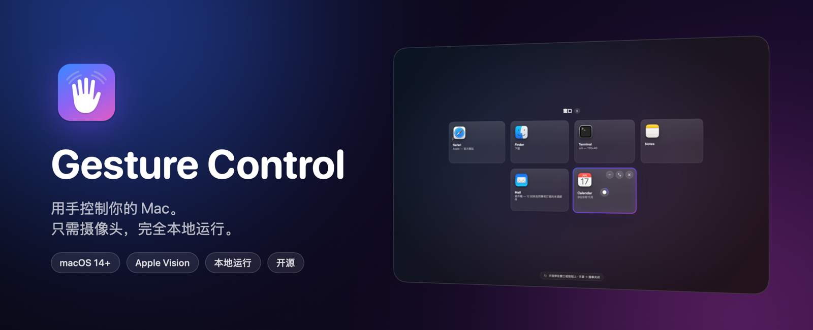
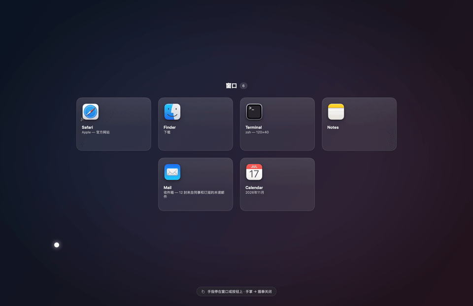
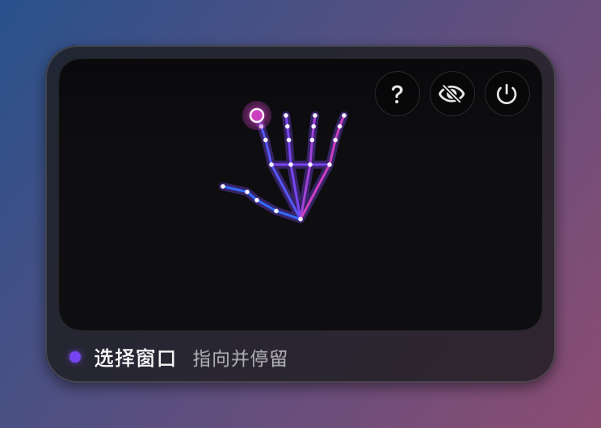
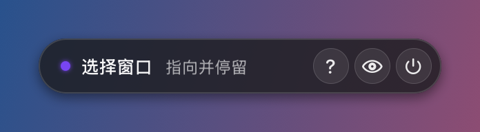
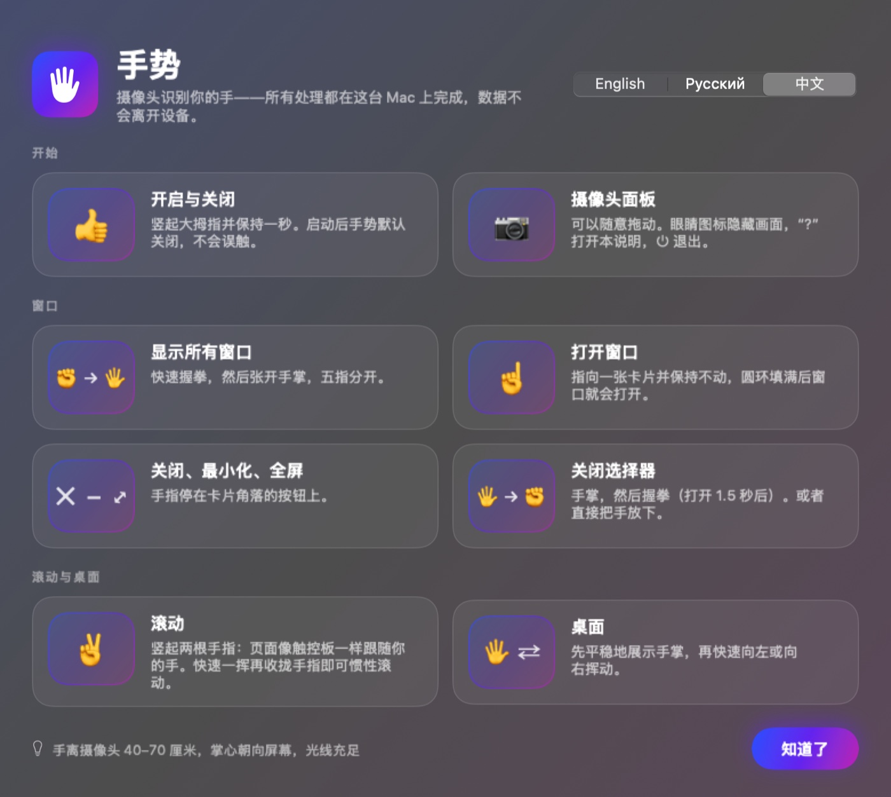

<p align="center">
  
</p>

<p align="center">
  <a href="README.md">English</a> · <a href="README.ru.md">Русский</a> · <b>简体中文</b>
</p>

<p align="center">
  <a href="https://github.com/RazinAleksandr/gesture-control/releases/latest"></a>
  
  
  
  <a href="LICENSE"></a>
</p>

<p align="center">
  <a href="https://github.com/RazinAleksandr/gesture-control/releases/latest/download/GestureControl-macOS.zip">
    
  </a>
</p>

<p align="center">
  只用内置摄像头，就能用手势切换窗口、滚动页面、切换桌面。<br>
  无需额外硬件，不上云，无第三方依赖。一个 1.5&nbsp;MB 的菜单栏应用。
</p>

<p align="center">
  
</p>

---

## ✨ 亮点

|  |  |
|---|---|
| 🪟 **一根手指选窗口** | 快速握拳 → 张开手掌，所有窗口以玻璃卡片形式展示。指向一张卡片并保持不动，窗口就会打开。关闭、最小化、全屏也是同样的操作。 |
| 📜 **像触控板一样滚动** | 竖起两根手指，页面跟随你的手移动；快速一挥再收拢手指，即可惯性滚动。 |
| 🖥️ **切换桌面** | 先平稳地展示手掌，再快速向左或向右挥动。 |
| 👍 **默认安全** | 启动后手势处于关闭状态。竖起大拇指保持一秒即可开启或关闭，说话时的手势不会误触任何操作。 |
| 🎥 **玻璃风格摄像头面板** | 一个可拖动的小面板，显示摄像头画面、手部骨架和当前模式，也可以收起成一个小胶囊。 |
| 🔒 **注重隐私** | Apple Vision 在你的 Mac 本地运行，画面只在内存中处理，应用里完全没有网络代码。 |
| 🌐 **English · Русский · 中文** | 默认跟随系统语言，可随时在手势说明或菜单中切换。 |

## 🖐️ 手势

| 手势 | 作用 |
|:--|:--|
| 👍 &nbsp;竖起大拇指，保持约 1 秒 | **开启 / 关闭**手势 |
| ✊ → 🖐️ &nbsp;快速握拳，然后**五指张开** | **显示所有窗口** |
| ☝️ &nbsp;指向一张卡片并保持不动 | **打开该窗口**（圆环先填满） |
| ☝️ &nbsp;停留在卡片角落的 **✕ · − · ⤢** 上 | **关闭** · **最小化** · **全屏** |
| 🖐️ → ✊ &nbsp;手掌，然后握拳（打开 1.5 秒后） | **关闭选择器**，或者直接把手放下 |
| ✌️ &nbsp;竖起两根手指并移动手 | **滚动**，快速一挥可惯性滚动 |
| 🖐️ ⇄ &nbsp;平稳的手掌，然后快速挥动 | **上一个 / 下一个桌面** |

> [!TIP]
> 手离摄像头 40–70 厘米，掌心朝向屏幕，光线充足。随时可以点击面板上的 **?** 查看内置的手势说明。

## 🎛️ 界面

<table>
  <tr>
    <td width="50%" align="center"><br><sub><b>摄像头面板</b>：可随意拖动。<b>?</b> 打开说明，眼睛图标隐藏画面，<b>⏻</b> 退出。</sub></td>
    <td width="50%" align="center"><br><sub><b>收起状态</b>：只显示模式和按钮。</sub><br><br><br><sub><b>手势说明</b>：首次启动时自动打开，可在顶部切换语言。</sub></td>
  </tr>
</table>

## 🚀 安装

1. **下载** [`GestureControl-macOS.zip`](https://github.com/RazinAleksandr/gesture-control/releases/latest/download/GestureControl-macOS.zip)，解压后把 **Gesture Control** 拖进「应用程序」文件夹。
2. **首次启动。** 应用没有经过公证（没有付费的 Apple 开发者 ID），macOS 会拦截一次：
   点击 **「完成」**（不要点「移到废纸篓」）→ 系统设置 → 隐私与安全性 → 滚动到底部 → **「仍要打开」** → **「打开」**。
3. **允许使用摄像头**。
4. **开启辅助功能权限**：系统设置 → 隐私与安全性 → 辅助功能 → Gesture Control。滚动、切换桌面以及管理窗口都需要它，无需重启。
5. 菜单栏出现 ✋，并弹出手势说明。竖起大拇指一秒，即可开始使用。

<details>
<summary><b>想用终端完成第 2 步？</b></summary>

```bash
xattr -dr com.apple.quarantine "/Applications/Gesture Control.app"
```
在 macOS 14 上，也可以右键点击 → **打开**。
</details>

**系统要求：** macOS 14 Sonoma 或更高版本 · Apple Silicon 或 Intel · 内置或外接摄像头。

## 🛠️ 从源码构建

```bash
git clone https://github.com/RazinAleksandr/gesture-control.git
cd gesture-control
scripts/build-app.sh      # → dist/Gesture Control.app + dist/GestureControl-macOS.zip
```

只需要 Xcode Command Line Tools（`xcode-select --install`）。开发时使用 `./build.sh && ./run.sh`，重新编译不会丢失权限；`--selftest` 无需摄像头即可运行 34 个手势场景。更多细节见[英文 README](README.md#️-build-from-source)。

## 🔒 隐私

摄像头画面由 Apple 的本地 Vision 框架在内存中处理后立即丢弃，不录制、不存储、不上传——应用里没有任何网络代码。辅助功能权限仅用于列出、前置、最小化、全屏和关闭窗口，以及发送滚动和方向键事件。

## ❓ 常见问题

<details><summary><b>对我的手没有反应。</b></summary>

确认手势已开启（竖起大拇指一秒，屏幕顶部会出现提示），摄像头面板里能看到手部骨架，并且手距离摄像头 40–70 厘米、掌心朝向屏幕。滚动和切换桌面还需要辅助功能权限。
</details>

<details><summary><b>如何切换语言？</b></summary>

界面默认跟随系统语言（英文、俄文或中文）。可以随时在手势说明窗口顶部（**?** 按钮）或菜单 ✋ → 「语言」中切换。
</details>

<details><summary><b>无法切换桌面。</b></summary>

请在「键盘 → 键盘快捷键 → 调度中心」中启用「向左 / 向右移动一个空间」（Ctrl ← / →），并确保有不止一个桌面。
</details>

## 🗺️ 路线图

- [x] 停留选择窗口与窗口按钮
- [x] 带惯性的滚动、切换桌面
- [x] 👍 开关、玻璃风格摄像头面板、手势说明
- [x] 英文、俄文和中文界面
- [ ] 实时窗口缩略图
- [ ] 自定义手势与设置窗口
- [ ] 指针模式，随处点击
- [ ] 经过公证的版本

## 📄 许可证

[MIT](LICENSE) © 2026 Aleksandr Razin
